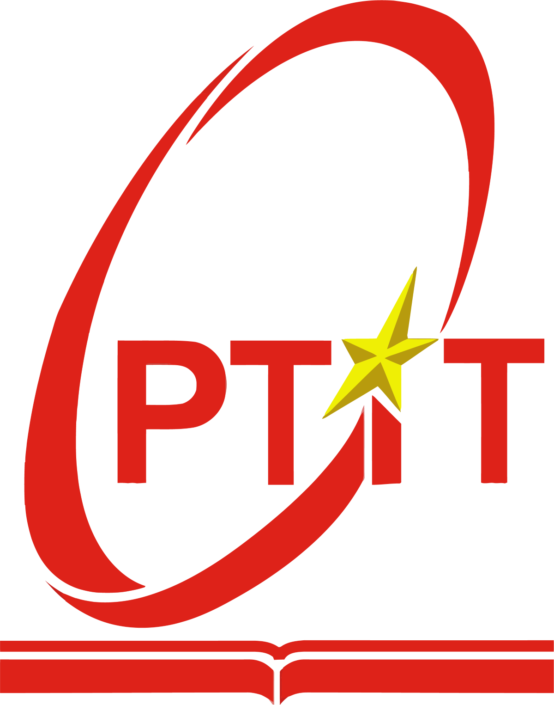

<div align="center">
  
  <h1>PTIT Study Hub — Cổng Ôn Tập &amp; Học Tập Tổng Hợp</h1>
  <p>
    <strong>Cổng luyện thi trắc nghiệm KaTeX, phòng học 36 video bài giảng và kho học liệu JSON</strong><br/>
    <sub>Thiết kế theo nhận diện Học viện Công nghệ Bưu chính Viễn thông (PTIT) · Zero-Backend · Chạy 100% trên trình duyệt</sub>
  </p>

  <p>
    
    
    
    
    
  </p>
</div>

---

## Mục lục

- [1. Tổng quan dự án](#1-tổng-quan-dự-án)
- [2. Tính năng &amp; Thiết kế nổi bật](#2-tính-năng--thiết-kế-nổi-bật)
- [3. Hướng dẫn chạy &amp; Đưa lên GitHub Pages](#3-hướng-dẫn-chạy--đưa-lên-github-pages)
- [4. Cấu trúc thư mục](#4-cấu-trúc-thư-mục)
- [5. Liên kết sâu (Deep-Linking) &amp; Phím tắt](#5-liên-kết-sâu-deep-linking--phím-tắt)
- [6. Lưu trữ cục bộ (`localStorage`)](#6-lưu-trữ-cục-bộ-localstorage)
- [7. Tài liệu PDF đi kèm](#7-tài-liệu-pdf-đi-kèm)

---

## 1. Tổng quan dự án

**PTIT Study Hub** tổng hợp **2.000 câu hỏi trắc nghiệm** (`1.000` câu Toán Rời Rạc + `1.000` câu Vật Lý 3) có lời giải chi tiết bằng công thức toán/lý **KaTeX**, đi kèm **36 video bài giảng** (Toán Rời Rạc 1 &amp; Vật Lý 3) và **39 tệp dữ liệu JSON** chuẩn hóa (`36` bộ đề hiển thị trực tiếp trong danh mục Trang Tổng). Toàn bộ ứng dụng không cần backend, dữ liệu tiến độ và ghi chú được lưu tự động trên `localStorage` của trình duyệt.

| Phân hệ | Đường dẫn | Quy mô dữ liệu | Điểm nổi bật |
|---|---|---|---|
| **Trang Tổng (Hub)** | `index.html` | Tổng hợp `2.000 câu` · `36 mục` catalog | Nền Canvas đồ thị/lượng tử 60fps, Hero 3D + gradient động, 3D Tilt &amp; Spotlight, đếm số mượt `requestAnimationFrame`, Bottom Nav Mobile, tìm kiếm `Ctrl + K` |
| **Toán Rời Rạc 1 &amp; 2** | `toán rời rạc/index.html` | `1.000 câu` · `8` chương · `25` tệp `.json` | Giao diện đồng bộ PTIT, 28 bộ đề (`EXAM_SETS`), thi thử đếm ngược, bảng câu hỏi (Palette), Sổ tay 5 chương, Máy tính khoa học, Nhập/Xuất JSON |
| **Vật Lý 3 &amp; Thí Nghiệm** | `vatly3/index.html` | `1.000 câu` · `10 × 100c` + Thực hành · `14` tệp `.json` | `10` Đề cuối kỳ (50 câu), `2` Đề chuyên đề P1–P2, bộ `500` câu mới sinh, Bảng hằng số vật lý &amp; Sổ tay công thức, Máy tính khoa học |
| **Phòng Học Video** | `video/index.html` | `36 video` (`8` TRR Ch 1–5 + `28` VL3 Ch 1–9) | Phát YouTube trực tiếp theo chương, tìm kiếm &amp; lọc theo môn, gắn link/thêm playlist cá nhân, phát file `.mp4/.webm` offline, tự lưu ghi chú bài giảng |
| **Trình chạy cục bộ (Windows)** | `mo-ptit-study-hub.bat` | Zero-config launcher | Bật HTTP server `127.0.0.1:8080` bằng 1 cú nhấp đúp để trình duyệt gửi `Referer` hợp lệ khi nhúng YouTube (tránh Lỗi 153 trên `file://`) |

---

## 2. Tính năng &amp; Thiết kế nổi bật

### 2.1. Bảng màu Công thái học PTIT (Ergonomic Palette)
Toàn bộ 4 trang đồng bộ theme theo nguyên tắc **60–30–10** giúp chống lóa và giảm mỏi mắt khi ôn thi dài:
- **Chế độ Sáng (Warm Paper):** Nền giấy ấm `#f6f5f2`, card `#fcfbf9`, ô phụ `#f1efeb`, viền trung tính `#e6e2de`.
- **Chế độ Tối (Carbon Slate):** Nền than chì `#0f1012`, card `#17181c`, ô phụ `#202227`, chữ chính `#ece9ea` (trắng ngà chống nhòe quang học).
- **Nhấn thương hiệu PTIT:** Đỏ PTIT (`#b80000` / `#e11d48`) và Vàng Amber cho logo, badge tiến độ, CTA và viền hover.

### 2.2. Animation GPU 60fps &amp; Responsive đa thiết bị
- **Constellation Canvas (`#bgConstellation`):** Mô phỏng mạng lưới đồ thị / hạt lượng tử phản ứng theo chuột; tự giảm mật độ hạt trên Mobile (`26` hạt so với `62` trên Desktop) và tạm dừng khi ẩn tab.
- **Tương tác Hero &amp; Thẻ 3D:** Gradient chuyển động mượt kết hợp nghiêng phối cảnh `perspective(1000px)` và **Radial Spotlight Glow** (chỉ kích hoạt trên thiết bị `@media (hover: hover) and (pointer: fine)`).
- **Magnetic CTA &amp; Shimmer Sweep:** Nút hành động chính trong `#hero` có lực hút nhẹ theo chuột và vệt sáng quét ngang.
- **Responsive Mobile/Tablet/Desktop:**
  - `scroll-snap` toàn màn hình chỉ bật trên Desktop rộng (`min-width: 1024px` &amp; `min-height: 760px`), loại bỏ kẹt cuộn trên điện thoại.
  - **Floating Bottom Navigation Bar** kính mờ hiển thị trên màn hình nhỏ (`< 768px`) tự highlight mục đang xem (`Tổng quan`, `Môn học`, `Video`, `Kho đề`, `Nhật ký`).
  - Bộ lọc `#catalogFilterTabs` trượt ngang mượt mà không rớt dòng; tôn trọng `@media (prefers-reduced-motion: reduce)`.

### 2.3. Lộ trình 36 Video Bài Giảng tích hợp
- **Toán Rời Rạc 1 PTIT (`8` bài — Chương 1 đến Chương 5):** Một số kiến thức cơ bản (P1, P2), Bài toán đếm (P1, P2), Bài toán liệt kê, Bài toán tối ưu (P1, P2), Bài toán tồn tại.
- **Vật Lý 3 (`28` bài — Chương 1 đến Chương 9):** Dao động và Sóng, Giao thoa ánh sáng, Nhiễu xạ ánh sáng, Tán sắc – Tán xạ – Hấp thụ, Phân cực ánh sáng, Cơ học tương đối, Quang học lượng tử, Cơ học lượng tử, Vật lý nguyên tử.
- Mỗi bài giảng đều liên kết thẳng tới bộ đề trắc nghiệm tương ứng (`Làm đề chương này`) và hỗ trợ ghi chú tự động lưu theo từng video.

---

## 3. Hướng dẫn chạy &amp; Đưa lên GitHub Pages

> **Lưu ý về trình phát YouTube (`Error 153`):** Các trình duyệt hiện đại không gửi HTTP `Referer` khi mở file trực tiếp bằng giao thức `file://`, khiến YouTube từ chối nhúng `<iframe>`. Để xem video **trực tiếp trong trang**, hãy chạy qua máy chủ HTTP cục bộ hoặc deploy lên **GitHub Pages (`https://`)**.

### Cách 1: Đưa lên GitHub &amp; Bật GitHub Pages (Khuyên dùng)
1. Push mã nguồn lên repository GitHub của bạn:
   ```bash
   git init
   git add .
   git commit -m "Initial commit: PTIT Study Hub"
   git branch -M main
   git remote add origin https://github.com/LeeHiennn/ptit_hub.git
   git push -u origin main
   ```
2. Vào **Settings → Pages** trên GitHub repository:
   - **Source:** `Deploy from a branch`
   - **Branch:** `main` · Folder: `/ (root)` → bấm **Save**
3. Sau 1–2 phút, trang web hoạt động tại `https://leehiennn.github.io/ptit_hub/` với đầy đủ HTTPS, làm bài thi và xem toàn bộ 36 video trên mọi thiết bị.

### Cách 2: Chạy trên máy Windows (1-click)
Nhấp đúp tệp **`mo-ptit-study-hub.bat`** ở thư mục gốc. Script tự động bật máy chủ tại `http://127.0.0.1:8080` (ưu tiên Node.js, dự phòng Python) và mở trình duyệt ngay lập tức.

### Cách 3: Chạy bằng Terminal (Windows / macOS / Linux)
```bash
# Dùng Node.js
npx serve .

# Hoặc dùng Python
python -m http.server 8080
```
Sau đó mở trình duyệt tại `http://localhost:8080`.

---

## 4. Cấu trúc thư mục

```text
ptit-study-hub/
├── index.html                              # Trang Tổng PTIT Study Hub
├── mo-ptit-study-hub.bat                   # Trình bật HTTP server cục bộ cho Windows
├── README.md                               # Tài liệu dự án (Markdown cho GitHub)
├── PTIT-Study-Hub-Gioi-Thieu-Du-An.pdf     # Tài liệu giới thiệu dự án (PDF)
├── .gitignore                              # Loại trừ file tạm khi đẩy lên GitHub
├── assets/                                 # Logo chính thức PTIT (PNG)
│   ├── ptit-logo-simple.png
│   └── ptit-logo.png
├── toán rời rạc/                           # Ứng dụng ôn tập Toán Rời Rạc (1000 câu) + 25 tệp JSON
│   └── index.html
├── vatly3/                                 # Ứng dụng ôn tập Vật Lý 3 (1000 câu) + 14 tệp JSON
│   └── index.html
└── video/                                  # Phòng Học Video (36 bài giảng + Kho cá nhân)
    └── index.html
```

<details>
<summary><strong>Xem danh sách chi tiết 39 tệp dữ liệu JSON (25 Toán Rời Rạc + 14 Vật Lý 3)</strong></summary>

**`toán rời rạc/` (25 tệp JSON):**
- `de-1-logic-tap-hop-thuat-toan.json` · `de-2-bai-toan-dem-bu-tru.json` · `de-3-he-thuc-truy-hoi-ham-sinh.json` · `de-4-liet-ke-sinh-quay-lui-ton-tai.json` · `de-5-toi-uu-nhanh-can-do-thi.json`
- `de-6-kiem-tra-ptit-so-1.json` → `de-10-kiem-tra-ptit-so-5-nang-cao.json`
- `de-11-chuong-1a-logic-suy-dien-boole.json` · `de-12-chuong-1b-tap-hop-quan-he-ham-do-phuc-tap.json` · `de-13-chuong-2a-dem-to-hop-bu-tru.json` · `de-14-chuong-2b-truy-hoi-ham-sinh.json` · `de-15-chuong-3-4-sinh-quay-lui-ton-tai.json` · `de-16-chuong-5-toi-uu-nhanh-can.json` · `de-17-chuong-6a-do-thi-duyet-euler-hamilton.json` · `de-18-chuong-6b-do-thi-phang-cay-mst-duong-di-ngan-nhat.json`
- `de-mau-toan-roi-rac.json` · `ngan-hang-80-cau-toan-roi-rac-ptit.json` · `ngan-hang-160-cau-toan-roi-rac-ptit.json` · `ngan-hang-240-cau-mo-rong-toan-roi-rac.json` · `ngan-hang-400-cau-toan-roi-rac-ptit.json` · `ngan-hang-600-cau-bo-sung-toan-roi-rac.json` · `ngan-hang-1000-cau-toan-roi-rac-ptit.json`

**`vatly3/` (14 tệp JSON):**
- `de-thi-cuoi-ky-so-1-50-cau.json` → `de-thi-cuoi-ky-so-6-50-cau.json`
- `de-on-tap-phan-1-quang-hoc-song-50-cau.json` · `de-on-tap-phan-2-luong-tu-chat-ran-50-cau.json` · `de-thuc-hanh-thi-nghiem-sai-so.json`
- `ngan-hang-85-cau-vat-ly-3-ptit.json` · `ngan-hang-200-cau-moi-vat-ly-3-ptit.json` · `ngan-hang-500-cau-vat-ly-3-ptit.json` · `ngan-hang-500-cau-moi-vat-ly-3-ptit.json` · `ngan-hang-1000-cau-vat-ly-3-ptit.json`

</details>

---

## 5. Liên kết sâu (Deep-Linking) &amp; Phím tắt

### URL Deep-Linking
- **Toán Rời Rạc:** `toán rời rạc/index.html?exam=de1`..`de5`, `ptit1`..`ptit5`, `ch1a`..`ch6b`, `ch1a_plus`..`ch6b_plus`, `ext600`, `all1000`, `random15`, `random25`, `random40` *(kèm `&mode=exam` hoặc `&mode=practice`)*.
- **Vật Lý 3:** `vatly3/index.html?exam=ck1`..`ck10`, `gk1`, `gk2`, `thuchanh`, `new200`, `new500`, `all500`, `all1000` *(kèm `&mode=exam|practice`)*.
- **Phòng Học Video:** `video/index.html?group=trr` · `?group=vl3` · `?id=vid-trr-1`..`vid-trr-8` · `?id=vid-vl3-1`..`vid-vl3-28` · `?tab=custom`.

### Phím tắt hỗ trợ
- **Trang Tổng (`index.html`):** `Ctrl + K` (hoặc `Cmd + K`) để tìm nhanh bộ đề.
- **Màn hình làm đề:** `A–D` hoặc `1–4` chọn đáp án · `← / →` chuyển câu · `F` gắn cờ xem lại.

---

## 6. Lưu trữ cục bộ (`localStorage`)

| Khóa `localStorage` | Mục đích |
|---|---|
| `ptit_hub_theme_v1`, `discrete_math_theme_v1`, `vlttn3_theme` | Đồng bộ giao diện Sáng / Tối giữa toàn bộ 4 trang |
| `discrete_math_quiz_best_v1`, `discrete_math_quiz_history_v1`, `discrete_math_quiz_progress_v1` | Kỷ lục điểm `/10`, lịch sử và tiến độ Toán Rời Rạc |
| `vlttn3_history`, `vlttn3_progress` | Lịch sử làm bài và tiến độ câu đã luyện Vật Lý 3 |
| `ptit_hub_watched_videos_v1`, `ptit_hub_lesson_links_v1`, `ptit_hub_custom_videos_v1`, `ptit_hub_video_notes_v1` | Tiến độ `0/36` bài giảng, link gắn thêm, video cá nhân và ghi chú |

---

## 7. Tài liệu PDF đi kèm

Xem bản trình bày tổng quan được dàn trang A4 sạch sẽ tại: [**PTIT-Study-Hub-Gioi-Thieu-Du-An.pdf**](PTIT-Study-Hub-Gioi-Thieu-Du-An.pdf).
